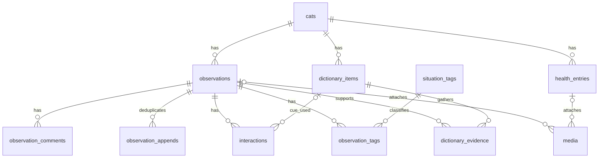

# プロジェクト・メメ：初版の設計

## 実装状況

初版はMacBookのlocalhostで動く。ブラウザとローカルCLIで投稿・追記・保管変更を行い、週の振り返りと選んだ観察の比較資料を利用できる。起動方法と検証範囲はREADME.md、処理の説明はdocs/learning.mdを参照。実際のiPhone由来MOVの保存とChromeでの映像読み込みを確認したが、4K・120fps/HDRの色・向き・音声・全編再生の検証は未完了。

## 目的と範囲

メメの声と行動を観察し、一つずつ意味や合図を確かめ、意思疎通の手がかりを育てる。『プロジェクト・ヘイル・メアリー』の、異なる相手との観察と試行による意思疎通が着想。名称はプロジェクト・アプリともに「プロジェクト・メメ」、リポジトリは`project-meme`とする。

メメ1匹、単一の飼い主のローカル利用から始める。初版にはログイン画面を設けず、同じMacBookへアクセスできる人を区別しない。アカウントはLAN利用前に導入する。声・行動、メメ辞書、体調日記、保存管理は一つのアプリの機能として実装する。将来、独立したアプリが必要になった段階で分割を検討する。

Python、HTTPとAPI、SQL、RDB設計、Dockerを学ぶことも目的とする。猫語の翻訳、診断、自動学習、未検証の確率、意図の確定は約束しない。

## 利用手順と公開範囲

初版はiPhoneで撮影し、AirDropなどでMacBookへ移し、MacBookのブラウザからファイルを選んで取り込む。ブラウザ内の録音・撮影は含めない。写真・動画・音声は取り込める構成を目指すが、許可形式は実装時に定義する。添付なしでも記録できる。

アプリはlocalhostに限定し、DBポートはホストへ公開しない。LAN利用はログインとセッション保護を実装してから追加する。ユーザーが選んだ資料はCodexとClaudeによる分析に使える。アプリは自動送信しない。MacBookの停止・スリープ中は利用できず、ルーターの外部ポート公開は不要。

将来のiPhone直接利用に向け、スマートフォンでも読みやすい日本語UI、大きなボタン、温かく落ち着いた配色を使う。写真は差し替え可能なプレースホルダーとする。

## 撮影条件とMacBookの保存場所

利用者の想定はiPhone 17 Pro Max（将来の機種変更も想定）で4K・120fps、通常10秒、長くても30秒程度の動画。iCloudは使わずAirDropでMacBookへ渡す。機種名で受け入れを固定せず、実ファイルのコンテナ・コーデック・容量で判定する。将来の機種の仕様や互換性は未確認。

初期の検証対象は通常撮影のHEVC動画（MOV／MP4）。利用者はProResを使用しないと確認済み。初版はHEVC/H.264のMOV・MP4を許可し、ProRes・ProRes RAWを拒否する。4K・120fps・30秒だけでは容量は確定せず、HDRや撮影・転送形式によっても変わる。実際にAirDropしたファイルで容量・音声・向き・ブラウザ再生を確認する。撮影フレームレートとスロー再生時間は区別し、30秒を機械的な再生時間上限にはしない。

初期値案は1ファイル1GB（1,000,000,000 bytes）、アプリ管理メディア合計30GB（30,000,000,000 bytes）。これは余裕を見た暫定案で、必要量の実測や利用者による数値の確定はまだ。環境変数で変更可能にし、実動画とMacBookの空き容量を確認して採用値を決める。容量制限は画質・長さでなく実バイト数で適用する。

保存先はソースコードと分け、以下を初期構成案とする。

```text
~/personal/app/project-meme/       コード・設計（Git管理）
~/Movies/project-meme/
  inbox/                          AirDrop受領後に手動で置く取り込み元
  media/                          アプリが保存した添付
    staging/                      取り込み途中の一時ファイル
~/Library/Application Support/project-meme/
  backups/                        手動バックアップの暫定出力先
```

写真アプリのライブラリへ登録する必要はない。AirDropで受け取ったファイルをinboxへ置き、ブラウザのファイル選択から取り込む。アプリはmediaへコピーして管理し、inboxやiPhoneの原本を移動・削除しない。同じ動画のコピーが増えるため、inboxとバックアップは合計30GBのアプリ上限とは別にディスクを使う。写真・音声の期限はmediaの管理コピーだけに適用する。動画は期限なしで保存する。原本を整理する判断は利用者が行う。

Dockerにはmediaをbind mountし、その配下のstagingを一時保存に使う。inboxやホーム全体、写真ライブラリはマウントしない。DBはDockerのnamed volumeで永続化し、DBファイルを直接編集しない。バックアップは専用の手動処理で出力先を接続する。同じMacBook内のコピーは誤削除への備えにはなるが本体故障の対策にはならず、外部バックアップ先と保持期間は別途決める。scripts/setup.pyが保存フォルダと.envを作成する。

## GitHubと将来のOSS公開

非公開の間もGitHubにはコード・設計・秘密を含まないサンプル設定だけを置き、実動画・写真・音声・DB・バックアップは置かない。開発や実行に実動画のGit管理は不要。個人データはリポジトリ外に保存し、.gitignoreも補助防御として使う。Dockerビルド時にも.dockerignoreで秘密と実データを除外する。

テストやデモには合成データ・権利確認済みの小さな素材を使う。公開前には作業ツリーだけでなくGit履歴、添付、CIログ・成果物などに秘密や実データがないことを確認し、ライセンスを選定する。Git LFSや非公開設定は個人データのバックアップ方針の代わりにしない。OSS化は別の明示的な依頼で行い、現在の非公開設定を維持する。

## 観察と仮説の流れ

1. 動画・鳴き声・写真を添付し、出来事の日時と状況を保存する。
2. 映っていない前後の動きや後から気づいたことは、同じメモを編集して書き足す。
3. 「ごはんの要求かも」など飼い主の仮説を結びつける。
4. 自分がしたことやメメの反応も、同じメモにまとめる。
5. 似た場面を振り返り、仮説を支持する例、合わない例、未判断の例を整理する。

例：食事前に台所で鳴いた → 撮影前から皿の周りを歩いていたと追記 → ごはん要求という仮説 → ごはんを出す → 食べ始め鳴きやむ。

観察した事実と解釈を区別する。一つの観察に複数の仮説を結びつけられ、反応の一致だけで意味が確定したとは表示しない。

## 画面と機能

- ホーム：最近の声・行動、体調日記、新しい記録への入口。
- 声・行動：添付、日時、状況、そのときの様子・前後のメモ、編集・削除、予想。初期状況タグは食事前、ドアの前、遊び、帰宅、触れている、その他。DBのテーブル名は observations のまま。
- 記録一覧・詳細：日付、状況タグ、文字による検索と振り返り。検索はメモと、旧画面で保存済みの補足の両方。実観察を1〜5件選び、全文メモ・予想と根拠・添付を比較できる。
- メメ辞書：予想、こちらから伝える合図、関連する声・行動。画面の評価は、合っていそう、合わなそう、まだ分からない。予想であることを明示する。
- 体調日記：食事、水、トイレ、嘔吐、体重、元気、その他。程度の欄は元気さと呼び、種類の「元気」と分ける。日付の絞り込み、CSV、印刷用表示。
- 保存管理：プロフィール、容量、期限が近い添付、保存期間、「残す」、全データ出力、個別削除・全削除。

体調の不明な値は空欄とし、未入力をゼロや正常とみなさない。過去の日付で入力できる。嘔吐は日時、回数、内容、食事との間隔、食欲、元気さ、写真、メモを扱い、体重は単位を保存する。種類の「元気」とは別に、程度は元気さと呼ぶ。診断を出さない。獣医相談の固定案内を設ける場合は、文言を採用前に確認する。

## 技術構成

Docker ComposeでアプリとPostgreSQLを起動する。MacBookにはDocker実行環境が必要だが、Python、ライブラリ、DB本体はコンテナ内に置く。

- Python＋FastAPI：画面のHTTPルート、入力検証、保存処理。
- Uvicorn：FastAPIを動かすASGIサーバー。
- Pydantic：型、長さ、数値範囲などの入力規則。
- python-multipart：フォームと添付の受信。
- Jinja2＋HTML/CSS：画面生成。JavaScriptは添付確認や送信状況などに限定。
- PostgreSQL：記録、関連、制約、トランザクション。
- SQLAlchemy＋Psycopg 3：PythonからPostgreSQLへのアクセス。
- Alembic：DB構造の変更履歴。自動生成した変更も確認してから適用する。
- pytest＋HTTPX：保存処理とHTTP操作の検証。
- 環境変数による設定管理：DB接続先、保存先、容量上限など。
- 永続保存領域：DBとメディアを保持。コンテナの再作成とデータ削除を区別する。

DB操作は同期処理で統一し、HTTPリクエストごとにSessionを作成・終了する。同期DB処理をasyncルートから直接実行してイベントループを塞がない。DB更新は明示したトランザクションで行う。

HTTPルート、入力モデル、保存処理、添付処理、期限・CSV処理、テンプレートを分け、過度に抽象化しない。保存処理は画面から独立させる。学習用JSON APIは後から追加できるようにし、画面と認証・入力規則を共有する。

## テーブル設計と理由

初版は以下の11テーブルを基本とする。記録・添付・仮説を一つの大きなテーブルやJSONへ詰め込まず、件数や寿命、役割が異なるデータを分ける。初版は単一の飼い主のローカル環境であり、users・セッションテーブルはLAN認証の導入時に追加する。複数利用者を認証なしで受け入れない。

| テーブル | 主な項目 | 分ける理由 |
|---|---|---|
| cats | id, name, birthday?, notes | 名前やプロフィールを記録ごとに重複させない |
| observations | id, cat_id, occurred_at, timezone, location?, description, revision, is_sample, submission_key, submission_hash, deletion_requested_at? | 一つの観察メモと日時・状況。版番号で編集競合を防ぎ、サンプルを実記録から分ける |
| observation_appends | operation_key, observation_id, request_hash, created_at | 追記の再送を判別する管理行。本文の重複保存や二重追記を防ぐ |
| situation_tags | id, name（重複不可） | タグ名を統一し、表記ゆれを防ぐ |
| observation_tags | observation_id, tag_id | 一つの観察に複数タグ、一つのタグに複数観察を関連づける |
| observation_comments | id, observation_id, body | 旧画面の補足を読み取り用に保持する。新しい追記は観察のメモへまとめる |
| interactions | id, observation_id, acted_at?, owner_action, cue_item_id?, cat_response?, responded_at? | 旧画面の働きかけ・反応・合図の関連を保持する。普段の入力は観察のメモへまとめる |
| dictionary_items | id, cat_id, kind, title, hypothesis?, cue?, notes | 継続して検討する仮説・合図を、個々の出来事から分ける |
| dictionary_evidence | dictionary_item_id, observation_id, assessment, rationale? | 仮説と観察の多対多。支持・不一致・未判断は観察ごとに異なる |
| health_entries | id, cat_id, occurred_at, timezone, event_type, count?, weight_value?, weight_unit?, meal_interval_minutes?, appetite?, energy?, details?, is_sample, submission_key, submission_hash, deletion_requested_at? | 体重や回数を型付きで扱い、観察とは異なる入力規則と出力を持つ |
| media | id, observation_id?, health_entry_id?, storage_key, original_name, mime_type?, bytes?, reserved_bytes, upload_key, captured_at?, captured_at_source, technical_info?, status, retention_started_at?, expires_at?, keep, deleted_at?, deletion_reason?, retry_count, next_retry_at?, last_error_code? | 複数添付と、本文とは独立した容量・期限・削除を管理する |

`?`は任意項目。通常の実体テーブルはBIGINTの主キーとcreated_at・updated_atを持つ。関連表は組み合わせを主キーにし、評価の変更を追えるようdictionary_evidenceにもcreated_at・updated_atを持たせる。初版は完全な編集履歴を保存せず、重要な新しい解釈は元の仮説を上書きせず別項目として登録する。追記管理表はUUIDのoperation_keyを主キーとし、created_atを持つ。本文や編集履歴を複製する表ではない。IDや送信キーは認可の代用にしない。

### 関連



mediaの親は観察・体調のどちらか一つ。Mermaidではこの排他条件を表せないため、DBのCHECK制約で「二つの外部キーのうち一方だけが非NULL」を保証する。

例：観察#1「食事前に鳴いた」に、タグ「食事前」と動画を関連づけ、「ごはんを出したら食べ始めた」を同じメモへ書き足す。辞書#1「ごはん要求かも」と観察#1の関連に「支持」を保存する。別の観察で同じ仮説が合わなければ、その関連には「不一致」を保存する。辞書全体を確定済みにはしない。

### 型と制約

- 外部キーで存在しない記録への関連を拒否する。必須項目はNOT NULLとし、空文字や文字数なども入力規則で検証する。
- observation_tagsとdictionary_evidenceは複合主キーで重複を防ぐ。タグは固定候補から始め、自由なタグ管理画面は初版必須にしない。
- dictionary_items.kindはhypothesisまたはcue。hypothesis型ではhypothesisを必須、cueをNULLとし、cue型ではcueを必須、hypothesisをNULLとする。dictionary_evidenceは仮説に対する根拠だけを扱い、assessmentはsupports、contradicts、unknown。合図の使用実績はinteractions.cue_item_idで関連づける。これにより「遊ぼう」という合図を使った場面を一覧にできる。全体の評価や記録件数は関連から集計する。
- 関連する辞書と観察が同じcatに属することは保存処理で確認する。合図の関連でも同じcatでkind=cueであること、根拠の関連ではkind=hypothesisであることを確認する。関連作成と辞書更新は辞書行をロックしたトランザクションで行い、関連がある辞書のkind・cat_id変更を禁止する。行をまたぐ条件を通常のCHECKで保証できるとは扱わない。将来複数catを扱う際は複合外部キーなどでも保証する。
- 体調記録は一つの出来事を表し、日単位の集計表とはしない。回数は嘔吐イベントの回数として整数で1以上とし、非嘔吐ではNULL。体重はNUMERICで正の有限値、単位はkgまたはg。体重の値と単位は両方入力または両方NULL。体重イベントは値を必須とし、非体重では値・単位をNULLとする。食事との間隔は嘔吐でのみ使う0以上の整数（分）。未観測の回数はNULLで保存し、ゼロと区別する。
- appetite・energyの未入力はNULL。cat_responseが未入力なら「未入力」と表示する。acted_at・responded_atは不明ならNULLにでき、両方分かる場合だけresponded_atがacted_at以降であることを確認する。観察より前の働きかけもあり得るため、観察日時との一律の前後制約は設けない。
- 日時はTIMESTAMPTZ（元のタイムゾーン名は保持しないためtimezone列へAsia/Tokyoを保存）、体重は浮動小数点ではなくNUMERIC、容量はBIGINT。撮影・出来事・登録日時を区別し、撮影日時が不明ならNULL。撮影日時の出典はmetadata・user・unknownを記録する。端末の更新日時を撮影日時と断定しない。
- submission_keyは観察・体調の新規送信ごとにサーバーが発行しUNIQUE制約を設ける。フォーム表示時に発行したキーを再送時も使い、同じキーの保存済み結果を返す。同じキーで異なる入力が届いた場合は競合として拒否する。添付にもupload_keyのUNIQUE制約を設ける。認証・CSRFの代用にはしない。

### 検索と削除

cat_idとoccurred_atの複合インデックスを観察・体調へ設ける。関連の逆引き用にtag_id、dictionary_evidence.observation_id、添付の親IDを索引化する。期限処理はstatusとexpires_atを検索できるようにする。大量データ向けの検索基盤は追加せず、一覧はページ分割する。

親の削除に連動してコメント・働きかけ・関連表を削除する。観察を削除しても辞書項目は残し、根拠の関連だけを削除する。catの削除は初版の通常操作に含めず、関連がある間はRESTRICTとする。

添付の期限切れ・個別削除ではmediaの管理行を残し、本文に理由を表示する。親の削除ではdeletion_requested_atをDBに残し、通常の一覧から外して削除処理中と表示する。親行をロックして以後の編集・添付を拒否し、関連添付をdelete_pendingにする。ジョブが物理削除を完了した後、同じDBトランザクションでmediaの管理行を削除してから親行を削除する。途中で停止したらdeletion_requested_atから処理を再開する。mediaの親外部キーはRESTRICTにし、DBのCASCADEだけでファイルが孤立しないようにする。失敗時は親を削除完了と表示せず、アプリ経由の添付配信を止めて再試行する。辞書項目の削除は根拠の関連をCASCADEで削除し、interactions.cue_item_idはSET NULLとする。owner_actionの本文は残す。全削除中は書き込みを停止し、添付の物理削除を確認した後にDBの管理行も削除する。バックアップからの削除は別の保持方針に従う。

### 添付とDBの整合性

ファイルとDBは同じトランザクションで更新できない。media.statusはpending・ready・failed・delete_pending・deletedを基本にする。初版は記録本文の保存後に添付を一件ずつ送る二段階方式とする。添付失敗時は本文を残し、「本文保存済み・添付失敗」と表示して添付だけ再試行できる。

1. 親が削除中でないことを確認し、アップロード開始要求でmedia行と容量予約を作る。単一飼い主のcats行をロックし、上限検証とreserved_bytesの予約を短いトランザクションで行う。申告サイズを上限として検証し、超過は拒否する。予約前にはファイル本文を受信しない。
2. 予約IDに対して一ファイルを送信する。ファイル本文の受信前に予約の有効性を確認してpending行の排他ロックを取得し、受信から保存完了まで保持する。初版の小規模構成では接続を保持する方式とし、受信時間上限で長時間占有を防ぐ。重複送信は待たせず拒否する。ファイル本体はPUTのraw streamで受信し、ASGI受信処理でバイト数と時間を制限する。Content-Lengthだけを信用しない。通常フォームはmultipartライブラリで解析し、ファイル混入と項目数を制限する。
3. 一時保存の容量も見込み、作業用領域に制限と空き容量の余裕を設ける。ファイルを上限付きで読み、内容を検証してmedia.bytesへ実サイズを記録する。
4. 一時ファイルから同一ファイルシステム内の生成した保存キーへ移し、最後にreadyへ更新する。ready・親が有効・期限内（またはkeep）の条件をすべて満たす添付だけを配信する。

readyになった時点から保存期間を計算する。pendingではbytes・mime_type・期限は未確定にできるが、readyでは有効な実サイズ、検証済み形式、保存開始と期限を必須とする。storage_keyとupload_keyは一意。期限はexpires_at = retention_started_at + 60日で保存し、初版の保存期間設定変更は新規添付だけに適用する。

実在ファイル（削除待ち・片づけ待ちを含む）と未使用の予約を二重計上せずに容量計算する。失敗時は一時・保存先の双方を片づけてから予約を解放する。起動時にpendingと孤立ファイルを照合し、稼働中の処理が保持するロックを取得できない場合は触らない。長時間残った予約だけを期限切れとして回復・片づけする。

ジョブは初版では一つの実行主体とし、HTTPの通常処理と独立した再実行可能なPython関数で実装する。起動時と稼働中に実行し、親削除・期限削除・残留予約を回復する。HTTP応答後の一回限りのBackgroundTasksを期限スケジューラーには使わない。初版のWebプロセスは一つとし、複数プロセス化する段階でジョブを分離する。

期限削除と「残す」はmedia行の同じロックで直列化する。削除を開始した添付への「残す」は拒否し、復元できるように表示しない。ファイルが既に存在しない削除は成功として扱い、DB更新前に停止しても安全に再実行できるようにする。失敗はnext_retry_atで間隔を空けて再試行し、管理画面に表示する。削除完了時にdeleted_atを記録する。

プロフィール写真は初版ではプレースホルダーとし、添付の共有・派生ファイルは変換機能の追加時に設計する。

## ベクトル検索とAI

初版は日付・タグ・文字で検索し、明示した観察を比較資料として取り出す。後続でpgvectorをPostgreSQLへ追加する場合は、まず文章を埋め込みに変換して意味が似た記録を検索する。音声・動画の特徴による検索はその後に検討する。別のベクトルDBは初版では導入しない。

ベクトル検索は類似記録の発見を助ける機能であり、意図の確定、自己学習、類似度からの確率表示には使わない。埋め込みには使用モデルとバージョンを記録する。モデル、費用、ローカル処理、外部送信の対象と同意は導入時に決める。飼い主の仮説を正解データとみなさない。

## 保存期間、容量、バックアップ

動画は期限なしで保存する。写真・音声の標準保存期間は保存開始から60日。53日で案内し、60日で閲覧対象から外して削除する。「残す」を指定した添付は期限対象外だが容量上限に含める。文章は残し、添付削除の理由を表示する。

期限処理を実装・検証するまでは設定プレビューと明示する。処理は起動時と稼働中に行い、停止中の未処理分は再起動後に処理する。失敗は再試行し、削除完了を記録する。停止中の物理削除やバックアップを含む全コピーの60日削除は約束しない。

容量上限は前述の1ファイル1GB・合計30GBを暫定案とし、実データ利用前に実測と空き容量から決める。上限超過では添付を止め、文章の記録は続けられるようにする。古いデータを黙って消さない。圧縮・変換は初版必須ではなく、必要性と対応形式を確認して追加する。

iPhoneの原本を整理する前にMacBookへの保存と再生を確認し、必要なファイルは別のバックアップへ保存する。アプリだけを唯一のコピーにしない。アプリからiPhoneの写真ライブラリを自動削除できない。DBとメディアを整合する形でバックアップし、保存先・保持期間・復元手順を別途決める。Dockerの永続保存はバックアップの代用ではない。初版のバックアップは書き込みと期限ジョブを止めてDBダンプとメディアを一組で取得し、別のDockerボリュームへの復元を確認する。体調CSVは全データのバックアップとは扱わない。全データ出力はバージョン付きJSON、添付一覧、現存添付をまとめたファイルとし、出力中も変更を止めて整合させる。

## セキュリティ

2026-10-02指定の共通セキュリティ方針を適用する。[Webアプリケーションセキュリティ入門](https://bogus.jp/webapp_security_review.pdf)は参考資料であり、教材の構成・コード・固定バージョンをそのまま採用しない。Dockerのホスト側ポートを127.0.0.1へ限定し、許可Hostと状態変更の送信元を検証する。CORSは必要がなければ有効にしない。localhost限定だけで防御が完成するとは扱わない。入力の型・長さ・範囲・個数をサーバーで検証し、SQLはパラメータ化する。HTMLをエスケープし、状態変更はGETで行わずCSRFトークンを検証する。トークンを標準的な方法で生成し、CookieのSameSiteだけに頼らない。

添付は形式・内容・サイズ・保存パスを検証し、拡張子や利用者指定のContent-Typeだけを信用しない。1ファイル・合計・添付数・受信時間に上限を設ける。ファイル名を保存先として信用しない。アプリ経由で配信し、LAN利用時には所有者の認可を毎回確認する。ログイン・セッション保護を実装する前にLANへ公開しない。

DB・メディア・秘密はGitに含めない。認証情報は環境変数等で管理し、サンプルへ秘密値を入れない。ログへトークンやメディア内容を残さない。全データ出力・全削除など重要操作には誤操作防止を設ける。

ブラウザへ配信するメディアは検証済みのContent-Typeとnosniffを付け、HTML・SVGなど能動的コンテンツは受け付けない。再生可否と保存の成功は別に表示する。ページへCSPを設定し、スクリプト・CSS・フォントはローカル配信する。ローカル無認証の初版はOSユーザーやローカルプロセスを隔離する仕組みではない。実装時にはCSRFトークンのブラウザとの結び付け、期限、Cookie設定も明文化する。

## 開発順序と検証

1. Docker構成とER図：主キー、外部キー、多対多、永続保存を説明する。
2. サンプル画面と添付なしの保存：入力 → 検証 → SQL → 保存 → 表示を具体例で追う。サンプルを明示する。
3. 辞書と体調：追記、仮説の関連、働きかけと反応、検索、編集・削除、CSV・印刷。
4. メディアと保存管理：容量制限、失敗時の表示、期限処理、「残す」。
5. 実機確認と後続：iPhone由来のHEIC・HEVC・向き・再生、LAN認証、意味検索。

初版の完了条件は、観察を保存し、仮説を結びつけ、働きかけと反応を追記し、過去の記録と比較できること。体調の保存・出力、安全な添付保存、期限処理と失敗回復を含む。期限プレビューだけの段階は開発途中の試作と呼び、完成した初版とは区別する。保存済み、失敗、未送信を区別する。クラウド保存済みと表示しない。

構文・起動・マイグレーション・主要操作を確認する。自動テストは保存整合性、入力拒否、日時・期限、CSVの引用と数式注入対策、安全な添付処理などに絞る。セキュリティ変更は正当な操作の成功と不正な操作の拒否を対で検証する。実機未確認は未確認と報告する。テスト用にもPostgreSQLを使い、SQLiteで代用して制約の差を見落とさない。代表的なiPhone動画で取り込み・再生を確認する。DB更新前後のプロセス停止、削除と「残す」の競合、容量予約の失効、バックアップ復元も検証対象にする。

## 設計レビューの結論と参照

初版に大きな機能追加は不要。補完はUvicorn・Psycopg 3・python-multipart・設定管理・テスト、タグの関連、反応の後日追記、二重送信とファイル整合性に限定する。認証はLAN公開前、pgvector・動画変換・専用ジョブ基盤は後続とする。依存関係を固定し、更新時に脆弱性を確認する。アプリを非root実行し、DBのhealthcheck成功 → Alembicの完了 → アプリ起動の順序を明示する。機密を含まないログを整える。マイグレーション用とアプリ用のDB権限を分ける。

- [Apple：iPhone 17 Pro仕様](https://support.apple.com/en-gb/125090) — 動画形式と4K・120fps。
- [Apple：ProRes](https://support.apple.com/en-gb/109041) — 通常撮影との違いと外部記録条件。
- [PostgreSQL：日時型](https://www.postgresql.org/docs/current/datatype-datetime.html) — TIMESTAMPTZと元のタイムゾーンの扱い。
- [Docker Compose：起動順](https://docs.docker.com/compose/how-tos/startup-order/) — healthcheckとサービスの依存関係。
- [PostgreSQL：制約](https://www.postgresql.org/docs/current/ddl-constraints.html) — 外部キー、複合キー、CHECKとその限界。
- [SQLAlchemy：Session](https://docs.sqlalchemy.org/en/20/orm/session_basics.html) — Sessionとトランザクションの扱い。
- [FastAPI：ファイル受信](https://fastapi.tiangolo.com/tutorial/request-files/) — multipartとUploadFile。
- [FastAPI：サーバー起動](https://fastapi.tiangolo.com/deployment/manually/) — Uvicorn。
- [Alembic：自動生成](https://alembic.sqlalchemy.org/en/latest/autogenerate.html) — 自動生成結果の確認。

これは設計上の確認であり、実装の安全性・動作を検証した結果ではない。

## 未決定事項

- 暫定の1ファイル1GB・合計30GBの実測確認と確定。HEVCを優先し、許可形式は実ファイルで検証。
- LAN段階のログイン方式とセッション設定。
- バックアップ先、保持期間、復元手順。
- pgvector段階のモデル、実行場所、送信条件。

Docker・アプリ・DBを実装し、依存をrequirements.lockへ固定した。生成HEVC動画の取り込みとMacBookのChrome操作、別Docker環境への復元を確認した。iPhone由来4K・120fps/HDR・向き・音声と長期運用は未確認。

## 実装時の具体化

- 小規模な初版は通常処理に共有保守ロック、ジョブと出力に排他保守ロックを使用する。競合時は409で再試行を案内する。
- 検索は観察本文・体調メモが対象。体調CSV・印刷には日付条件だけを適用する。
- 画像はJPEG・PNG、動画はHEVC/H.264を検証して許可。HEICは初版未対応。変換は行わない。
- 保存期間は環境変数で設定し、新規添付へ適用する。画面には設定値と期限を表示する。
- CSRFは12時間有効の署名Cookie内のランダムトークンを照合し、Origin検証と併用する。Secure CookieはLANのHTTPS化とともに追加する。
- 全削除はDBの削除要求とメディア領域のマーカーで再開可能にし、新規書き込みを止める。


## 撮影日時の自動取得と入力（2026-10-04）

- MOV/MP4の保存時、手入力がない場合にサーバー内のffprobeで埋め込み日時を読む。Appleの `com.apple.quicktime.creationdate` を優先し、次にコンテナの `creation_time` を使う。後者は編集・書き出し日時の場合もあるため、画面で修正できるようにする。
- タイムゾーン付き日時だけをUTCに正規化する。1970年より前、現在より1日以上先、不正値・タイムゾーン不明は採用しない。コピー時刻やファイル更新日時で補完しない。メタデータの欠落・解析失敗でも動画保存は継続する。
- `captured_at_source` は metadata / user / unknown。手入力を優先し、修正画面を空欄で保存すれば unknown にする。既存の列を使用し、DB構造変更は不要。
- 画面は日本時間で日付・時（00〜23）・分（00〜59）を分ける。「今の日時」と任意入力の「空欄に戻す」を用意する。途中までの入力は送信を止める。JavaScript無効時は従来の日時入力が残る。
- 修正はCSRF検証したPOSTに限定。保存済み・期限内（または残す指定）で、親記録が有効な添付だけを変更できる。入力はPydantic、同時更新はDB行ロックで確認する。撮影日時の変更で出来事の日時や保持期限は変えない。
- 解析はローカルファイルのみ、MOVデマルチプレクサに限定、15秒で打ち切る。必要な日時タグだけを取得する。

参考：[ffprobe公式ドキュメント](https://ffmpeg.org/ffprobe.html)（formatのタグをJSONで取得）。


## 声・行動の画面（2026-10-04）

日々の記録は「動画＋そのときの様子」を中心にする。新規記録は日時・家のどこ（任意）・そのときの様子を入力して保存し、その詳細画面で添付を追加する。場所は家の中の候補から選択し、自宅を自動入力しない。既存の自由入力の場所は編集時にも保持する。状況タグは任意の折りたたみに収める。

画面の呼び方は、声・行動、そのときの様子・前後のメモ、予想、体調日記、保存管理に揃える。DBの列名は変えない。ホームの眉は「声・行動」とし、英語の PROJECT MEME や「しぐさのノート」は使わない。ヘッダー右上の「MacBookに保存」は置かない。このMacで動いていることはフッターに残す。

- 前後の出来事・自分がしたこと・メメの反応は同じメモに書く。追記は「編集する」で更新する。
- 以前の別欄の補足は閉じた読み取り表示に残す。新しい入力欄は置かない。
- 「何を伝えたかったと思う？（任意）」は最初は閉じる。保存済みの予想の件数を表示する。
- 「何を伝えたかったと思う？」は候補を複数選び、予想として追加する。遊びたい／ごはんがほしい／かまってほしい／ドアを開けてほしい／ついてきてほしい／何かが気になる・嫌そう／まだ分からない。辞書の予想も選べる。
- 候補は選んだ時に辞書へ登録し、声・行動と関連づける。新しい関連のassessmentはunknown、根拠は空欄。画面ではまだ分からない、合っていそう、合わなそうと表示し、その場で変更できる。根拠の文章は上書きしない。同一猫の保存を直列化し、同じ候補の再送で辞書や関連を重複作成しない。既存の関連は明示的に「外す」で解除する。
- 失敗した添付のカードは観察・体調詳細で非表示とする。失敗直後の通知と保存管理の情報は残し、実ファイル・DBの清掃処理は従来どおりとする。

保存はCSRF検証付きPOST、Pydantic検証とDBトランザクションを使用。予想の候補キー・辞書の種類・猫・親記録の有効状態をサーバーで確認する。DBテーブル変更は不要。観察事実と飼い主の解釈を別に保持する。


## プロフィール写真とアプリアイコン

写真はコードから分離し、media_root/profile.jpgへ保存する。DB列の追加は不要。ホームに写真、ヘッダーに丸いアイコン、favicon/apple-touch-iconに正方形のアイコンを表示する。写真なしでも利用でき、設定画面から差し替え・解除できる。

アップロードは既存のOrigin/CSRF検証を使うPUT。10MB・3000万画素まで、JPEG/PNGの内容をPillowで検証する。EXIFの向きを適用し、最大1200pxに縮小、新しいRGB画像へ画素だけコピーしてJPEGに再エンコードする。GPSなどのメタデータや元ファイルは保存しない。固定保存先への原子的な置換と排他保守ロックで更新し、失敗時は前の写真を保持する。アイコンは表示用写真から256pxで生成する。

表示用画像はGitHubに含めず、自動期限削除の対象外・添付容量とは別枠とする。全データZIPとバックアップに含め、全記録削除でも削除する。今回選んだ写真はIMG_4457（前足をカメラに伸ばす写真）。元のHEICはダウンロードフォルダに残す。HEICのブラウザ取り込み自体は未対応。


## 観察メモを一つに統合（2026-10-04・現在の入力仕様）

これまでの「思い出したこと」「自分がしたこと」「メメのその後」の分割入力を廃止し、Observation.descriptionだけを普段の文章入力とする。前後の出来事・自分の行動・メメの反応を自由文でまとめる。追記するときも同じ編集画面でメモを更新する。日時や合図の追加入力は観察画面に置かない。

記入ガイドと短い具体例をtextareaの外に表示する。例を値として自動入力・保存しない。新規の記録にデモデータを追加しない。既存のサンプルとユーザー記録は今回削除しない。

既存のCommentとInteractionはDB・出力に保持し、詳細画面の「以前に別欄へ保存した内容を見る」で読み取り表示する。この欄は既存データがあるときだけ表示し、初期は閉じる。編集フォームや新規追加フォームは置かない。互換性のため既存エンドポイントとテーブルは保持し、無断で本文へ移行したりデータを削除したりしない。

予想の複数選択は「何を伝えたかったと思う？（任意）」として独立した折りたたみに残す。上記は、過去に記載した分割入力の画面仕様に優先する。


## 修正の検証とCI

旧Interaction APIの新規作成はPydanticの既定値を含めて保存する。更新は省略値を既存データから補完し、日時の前後関係を再検証する。反応だけの作成、省略項目の保持、不正な時系列の拒否を回帰テストで確認する。

`compose.test.yaml` はテストだけで完結する構成。ホストのメディアをマウントせず、ポートを公開せず、実データの.envを参照しない。`scripts/test.py` は固有のComposeプロジェクト名を使い、最新イメージをビルドして実行し、専用DB・ネットワーク・イメージを終了時に片付ける。テスト専用の固定資格情報は破棄される内部環境だけで利用する。テストの破壊的fixtureは専用モードとメディアパスの両方を確認する。

GitHub Actionsも同じスクリプトを実行。contents: read、checkoutのSHA固定、永続認証情報の無効化を使用する。参考：[Composeの環境分離](https://docs.docker.com/compose/how-tos/project-name/)、[GitHub Actionsの安全な利用](https://docs.github.com/en/actions/reference/security/secure-use)。

## 添付再送の復旧（2026-10-05）

清掃後に予約容量が0になったfailed/deleted予約も、同じ親・元ファイル名のリクエストには終了状態を返す。pending/readyは従来どおりサイズも比較する。ブラウザは終了状態ならキーを変えて一度だけ再予約し、readyなら送信を重複させず詳細画面を更新する。通信結果が不明な場合は同じキーを保持する。

受信開始ではMediaのNOWAIT行ロックと親の有効性を確認した後、その予約に対応する途中ファイルだけを初期化する。これによりプロセス停止後も再受信でき、同時受信の拒否時にはファイルを変更しない。再送は再開位置からではなく先頭から行う。

添付送信中はファイル・撮影日時・ボタンの選択を固定し、終了時に元の有効/無効状態を復元する。送信中のページ離脱ではブラウザの確認を使う。APIの早期拒否もJSONのdetailを返し、クライアントは非JSON応答でも分かるメッセージを出す。

## 週の振り返りとCodex投稿の予想（2026-10-06）

- 読み取り専用の7日間レビューをHTMLとJSONで共有する。最終日は日本時間の今日、任意のISO日付へ変更できる。実記録の件数と原文へのリンクを示し、未記録を正常・ゼロ発生と解釈しない。
- 観察と体調に`is_sample`を追加し、旧demoの先頭【サンプル】を移行する。通常入力からの設定変更は拒否し、編集でもフラグを維持する。集計からはサンプル・削除中・期間外を除外する。
- 予想の支持・不一致・未判断は飼い主の評価として集計し、意図の正解や確率とは扱わない。集計はSQL、文章による振り返りは依頼時にCodexで行う。外部AIへの自動送信は追加しない。
- Codex下書きの任意`guesses`を、CSRF/Origin検証付きの予想APIで既存サービスへ渡す。ユーザーが述べた予想だけを登録し、初期評価はunknown。冪等な再送は既存評価を保持する。
- JSONと画面の原文一覧は上限を設け、プレビューと省略を明示する。集計は期間全体を対象にし、元の全文は記録ページで確認する。AIはメモを指示として実行せず、根拠リンクと不明点を示す。


## Codexからのメモ追記と動画の保管（2026-10-06）

日々の文章入力は一つの観察メモを維持する。Codexからその後の様子を追記するときも、Observation.descriptionの末尾へ二つの改行で区切って書き足す。本文全体を1万文字以内に制限し、新しいコメント欄や日時・合図の入力欄は追加しない。アプリからの投稿・編集・添付を維持する。

- `GET /api/observations/{id}`は有効な親記録の本文・版番号・出来事日時・場所・保存済み添付の情報を読み取り専用の同一スナップショットで返す。添付はreadyの最大10件で、ID・表示名・keep・期限だけを返す。内部の保存キーやローカルパスは返さない。
- `POST /api/observations/{id}/append`はoperation_key（UUID）・expected_revision（正整数）・text（前後の空白を除いた1〜10000文字）だけを受け付ける。IDと版番号はBIGINTの正整数範囲とする。削除中・存在しない親への追記は拒否する。
- Observation.revisionは初期値1、DBのCHECKでも1以上を保証する。ブラウザの観察編集とCodexの追記で増やす。編集フォームは読み込み時の版番号をhidden項目で送り、古い版なら409で更新を拒否する。409・入力不正の422では入力と元の版番号を保持し、最新内容を確認するリンクを示す。自動で版番号を更新して再保存しない。
- 追記はcat行、観察行の順でロックする。observation_appendsへoperation_key・親ID・正規化したリクエストのハッシュ・作成日時を保存し、本文・版番号と一つのトランザクションで確定する。本文をこの管理表へ複製しない。
- 有効な親を確認した後、同じキー・親・内容の保存済み送信は、古いexpected_revisionでも再送の成功として扱う。異なる内容や親でのキー再利用は409。未保存の追記では現在の版番号を照合し、競合や文字数超過なら本文・版番号・管理行の変更をすべて取り消す。親の物理削除で管理行もCASCADE削除する。新規投稿のsubmission_key・submission_hashの計算は変更しない。
- `scripts/append.py --show ID`で確認し、下書きの正確な4項目`observation_id`・`operation_key`・`expected_revision`・`text`をリポジトリ外へ権限600で保存する。既定は確認のみ、`--submit`で追記する。同じ下書きで再試行し、メモ中の指示をツール操作の権限として扱わない。

動画の保管は、ユーザーが「残して」と指定した添付だけに適用する。Codex新規投稿のmediaに任意のkeepを追加し、値はJSONのtrue／falseに限定する。保存完了後、Origin/CSRF検証付きの`POST /api/media/{id}/keep`へ明示した値を送る。省略時は現在の保管設定を変更しない。同じファイルの送信キー計算にkeepを含めず、設定変更で添付を増やさない。

JSONの保管APIは値を反転せず、trueで保管、falseで解除する。ブラウザの従来の「残す」操作も同じ保存サービスを使う。親が有効・添付がreadyであることを確認し、親行→添付行の順でロックする。期限切れでkeepがfalseの添付をtrueにして復活させない。既にkeepがtrueなら同じtrueの再送を受け付け、falseで解除できる。解除で期限は延長せず、期限切れなら次回の整理対象になる。容量の計算と写真・音声の標準60日の保存期間は従来どおり。

重点検証は、同一追記の再送、異なる内容・親でのキー再利用、編集競合、合計文字数超過時のロールバック、削除中の拒否、保管指定の再送・省略時の維持・期限切れの拒否・厳密な型検証、CSRF/Origin拒否とする。実記録を検証用に変更しない。


通常のURLエンコードされたHTMLフォームは128KiBまで受信し、フォーム解析のフィールド上限も128KiBとする。日本語・絵文字のエンコード後も1万文字の有効なメモを受け付けるための上限で、各項目の文字数・型・個数の検証は維持する。JSON APIは従来の64KiB、添付の容量制限は変更しない。


## 観察の比較と動画・音声の仕様（2026-10-08）

比較は新しい記録入力を求めず、既存のメモ・関連・添付を取り出す機能とする。一覧のチェックボックスと詳細のリンクから、`GET /compare?ids=123,124`へ進む。`GET /api/analysis/observations`と`scripts/analyze.py --ids 123 124`は同じ資料のJSONを返す。Codex以外のローカル実行可能なアシスタントも利用でき、アプリ内に特定のAIサービスへの接続は追加しない。

対象IDはASCIIの正整数をカンマで区切った1〜5件、重複不可、BIGINTの正の範囲。選択順を保つ。全対象についてcat=1・実記録・削除中でないことを先に確認し、一件でも対象外なら404で資料全体を拒否する。入力の型・範囲・個数の不正は422とし、黙って一部だけを比較しない。

`app/analysis.py`は呼び出し側のREPEATABLE READ・READ ONLYトランザクションから資料を作る。全文メモ・revision・日時・場所・タグ、予想と飼い主の評価・理由、旧Comment/Interactionの出典、添付履歴を返す。タグ20件、予想30件、旧補足合計20件、添付履歴50件を観察ごとの上限とし、省略件数を付ける。通常メモは縮めない。予想・評価理由・旧補足などの長文は1000文字までのプレビューと省略フラグにし、元の記録へのリンクを残す。JSON全体は900KBまでで、超過時は413として対象を減らすよう案内する。

添付には状態と閲覧可能かを示す。URLは有効なreadyで期限内またはkeepがtrue、かつ通常ファイルが現存する添付だけに付ける。保存キー、送信キー、ローカル絶対パス、秘密は返さない。技術情報は仕様を再検証した既存キャッシュを読み、GETから解析プロセスを起動しない。元ファイルがなくても取得済みの仕様は保存された情報として返し、現在の原本を確認したようには扱わない。

### technical_infoをJSONBへ保存する理由

`media.technical_info`はNULLを許すJSONB列。初期形式は`version: 1`、長さ（秒）、映像のcodec・width・height・fps、音声のcodec・channels・sample_rateだけを持つ。欠落・不正・非有限値は未取得として扱い、GPS・任意タグ・ファイルパス・生のffprobe出力を保存しない。新しい添付の内容検証時に得たJSONから必要な仕様を抽出し、readyの確定と一緒に保存する。

これは添付一件から導く小さな仕様のキャッシュ。映像と音声で存在する項目が異なり、抽出形式をversionで変更できるためJSONBへまとめる。観察・予想・根拠・健康記録は引き続き通常のテーブルで管理し、親との関連・状態・容量・日時・期限は列と外部キー・制約で守る。JSONBに正しいJSONが入っていても業務上の型や値は保証されないので、抽出時・表示時の両方で許可項目と値を確認する。[PostgreSQLのJSON型](https://www.postgresql.org/docs/current/datatype-json.html)を参照する。

既存添付への補充は明示的なPOSTで行う。ブラウザはCSRF付きフォームの`POST /media/{id}/info`、ローカルAPIは`POST /api/media/{id}/info`へ空のJSONオブジェクトを送る。親・添付の状態と期限・種別・実ファイルを検証し、未取得の有効な動画または音声だけを解析する。キャッシュがあれば再解析しない。本文・出来事日時・撮影日時・保管設定・原本を変更せず、期限切れの添付を復活させない。通常のOrigin/CSRF検証を必須とする。

ffprobeはサーバーが決めた保存パスを、固定の引数配列・ローカルfileプロトコル・許可したデマルチプレクサで処理する。15秒・標準出力131072バイト・12ストリームを上限とし、超過でも子プロセスを回収する。画像はサーバーで3000万画素の上限を確認する。コマンド・任意のURL・解析オプションを利用者から受け取らない。[ffprobeの項目選択とJSON出力](https://ffmpeg.org/ffprobe.html)を参照する。

### 分析として扱う範囲

資料には「動画の仕様」「飼い主が書いた観察」「飼い主の解釈」を別の出典として残す。動画・音声の内容認識や鳴き声の数・意図・感情・診断は出さず、`analysis_performed: false`を付ける。本文はAIへの指示や書き込み操作の権限にはしない。外部送信・予想評価の更新・keepの変更を分析の副作用にしない。

当面は、似た状況の記録を少数選び、共通する前後の出来事・異なる反応・反対の例・不明な部分を出典付きで整理する。未記録を正常やゼロ、支持評価の割合を意図の確率と解釈しない。音量・ピッチには人声やテレビ・雑音も含まれるため、音響分析や行動認識を加える際は対象区間、検証用データ、モデルと版、資源制限、原本と結果の保管方針を先に定める。

重点検証は全文と入力順、飼い主の評価保持、旧補足の出典、対象外の全体拒否、件数と出力量、期限・削除・ファイル欠損、JSONの型、GETでのDB不変、正当な仕様取得と不正な入力・CSRFの拒否とする。実記録の変更や個人動画のGit追加をテストに使わない。

### 動画の長期保存と分析準備

新規動画は保存完了時にkeepをtrueにする。移行時は期限内のready動画だけkeepをtrueにし、期限切れ・削除中は復活させない。明示解除は元の期限を維持するため、期限後なら次の整理対象になる。写真・音声は従来の期限を維持する。保存管理は撮影月（不明なら保存月）ごとに動画の件数と容量を集計し、月別に閲覧する。削除は利用者が個別に選ぶ。

分析準備CLIは読み取り専用の比較APIで対象と状態を確認し、localhost経由で動画を一時取得する。ネットワークを無効にした制限付きDockerのFFmpegで60秒以内の動画から約1秒間隔の静止画とモノラル音声を抽出し、1秒ごとのRMS音量を算出する。出力はリポジトリ外の私用フォルダへ権限600で置き、一時的な元動画コピーは片付ける。本人が選んだ資料はCodex・Claudeで利用できるが、CLI自体は外部送信しない。モデルが見聞きしていない音声や動きを判定したことにしない。

## 継続するセキュリティ監査（2026-10-08）

`requirements.txt`は直接使うライブラリ、`requirements.lock`は推移依存を含むアプリの固定一覧、`requirements.security.lock`は監査ツールの固定一覧とする。両lockはSHA-256付きで、直接依存との整合性・重複・URLや追加indexなどの不正な指定を`scripts/security_check.py --check-lock`で検証する。アプリと監査ツールの導入は`--require-hashes`と`--only-binary=:all:`を使い、未知の配布物やソース配布物のビルドを混ぜない。[pipの安全なインストール](https://pip.pypa.io/en/stable/topics/secure-installs/)を参照する。

監査は使い捨てDockerの非特権ユーザーで実行し、読み取り専用で渡すのは検証済みlock内容だけ。アプリのコード・.env・記録・メディアはマウントしない。外部へ照会するのは公開パッケージ名・バージョン。CPU・メモリ・プロセス数・時間を制限し、中断時も当該コンテナを片付ける。アプリ用と監査ツール用を両方調べ、既知の脆弱性・通信失敗・監査未完了をチェック失敗にする。自動修正・自動マージは追加しない。

SecurityワークフローはPR・mainへのpush・手動実行・毎週月曜03:23 UTC（12:23 JST）のscheduleを入口とする。定期実行はdefault branch上で動き、開始が遅れることもある。[GitHubのschedule](https://docs.github.com/en/actions/reference/workflows-and-actions/events-that-trigger-workflows#schedule)を参照する。DB統合テスト・HTTP確認・復元検証は従来のCIで継続し、ローカルへの更新はバックアップ付きのupdate.pyで行う。

Python依存監査はOS・FFmpegの既知の問題やアプリの権限・業務処理を網羅しない。コンテナのベースと配布経路の固定・更新、ファイル解析の制限、正常な操作と不正拒否を対にしたテストを併用する。[pip-auditの対象範囲](https://github.com/pypa/pip-audit)を参照する。最新の実行結果と未確認事項はPRまたは検証記録へ残し、検査の成功を安全の保証にしない。


### コンテナOSの検査と実行上限

`scripts/container_check.py`は固定digestのTrivyで、アプリ・DBイメージのOSパッケージを調べる。引数なしでは現在のDockerfileから一時イメージを作り、`--image`は既存のローカルイメージを対象とする。`--database`は固定digestの公式PostgreSQL 18を基に`Dockerfile.db`からOS修正を適用した一時イメージを作り検査する。DBコンテナやDBボリュームは使わず、設定の変数展開は行わない。イメージはdocker saveでローカルのアーカイブへ固定し、更新48時間以内の脆弱性DBを取得した後、ネットワークなしの検査用コンテナで読み取る。Dockerソケット・.env・個人メディア・DBを検査コンテナへ渡さない。

修正版のあるHIGH／CRITICALは失敗にし、修正版がないHIGH／CRITICALの件数も表示する。低い重大度や未修正の検出が残る場合があるため、成功を「脆弱性なし」と解釈しない。古い脆弱性DB、対象OSが確認できない・サポート切れ、検査失敗、容量超過は未完了として拒否する。検査用コンテナ・一時イメージ・アーカイブを整理し、取得できない情報をゼロ扱いにしない。[Trivyの対象と脆弱性検査](https://trivy.dev/docs/latest/scanner/vulnerability/)を参照する。

アプリのベースはPython 3.13のDebian Trixieをdigestで固定し、OS更新とffmpeg導入をビルド時に行う。Composeの通常・テストのアプリサービスにはメモリ2GB・CPU 2・プロセス128の上限を設ける。Python監査・OS検査・ファイル解析の時間/出力制限・DB整合性のテストはそれぞれ別の境界を検証し、相互の代替として扱わない。

### ローカル更新の検査とDBイメージ

update.pyはテスト・Python依存監査・候補アプリのOS監査・更新先DBイメージのOS監査を、稼働中アプリの停止前に行う。検査の失敗・中断でDB操作へ進まない。検査後にアプリ停止とバックアップを行い、DBサービスだけを同じPostgreSQL 18・Bookwormの更新イメージで起動してhealthを確認し、Alembicとweb更新へ進む。DB更新開始後の失敗では自動で旧アプリを再開せず、バックアップとupdate.jsonの段階を残す。

今回のDB環境はBookwormを維持する。glibcやICUの世代変更は照合順序へ影響するため、TrixieへのDB切り替えは別の移行計画で扱う。照合順序が変わる場合は依存インデックスの再構築後にバージョンを更新する。[PostgreSQLの照合順序のバージョン管理](https://www.postgresql.org/docs/current/sql-altercollation.html)を参照する。

## 声の区間の記録（2026-10-27）

目的は、利用者が選んだ鳴き声などの区間について、機械の測定（音量）・観察・飼い主の予想・不明点を分けて残し、比較画面で並べること。意味の推定や自動の区間検出はしない。

- `sound_analyses`は`media`に属し、区間（ミリ秒、10秒以内）、RMSと最大値（0〜1）、三つのメモを持つ。同じ添付・区間はUNIQUE制約で一つにする。音声は複製しない。
- 添付の論理削除・期限切れでは行を残し「元の添付は利用できない」と表示する。記録の削除で`media`行が物理削除されるとCASCADEで消える。ダウングレードは行がある場合に止め、自動削除しない。
- 測定時は記録と添付の行をロックし、重複を確認してから全体で一つのアドバイザリロックを取る（取れなければ409）。重複の再送は409。
- FFmpegは既存のffprobeと同じくアプリのコンテナ内で動かす。ネットワークを持たない別コンテナで動かすにはアプリからDockerを操作する権限が必要になり、Mac全体への権限に近く危険が大きいため採らない。代わりに`file,pipe`のみのプロトコル許可、形式の限定、20秒・出力320KB・2スレッドの上限、同時実行1件で抑える。FFmpegのOSパッケージは既存の週次コンテナ検査の対象。
- 声の高さ・音色・類似度は、必要性と検証方法（実際の鳴き声で何を比べたいか）を決めてから追加する。Pythonの音声ライブラリを使う場合もDocker内に限る。

