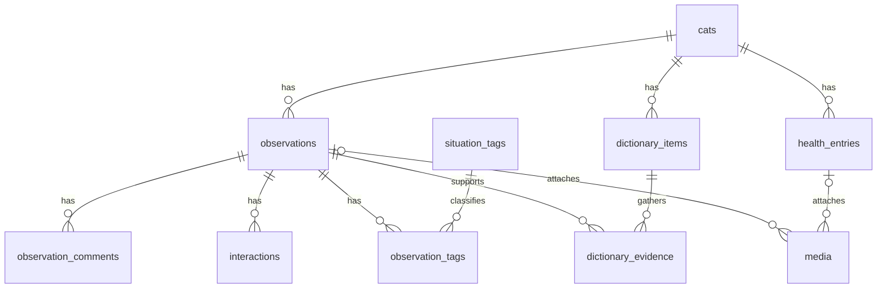

# プロジェクト・メメ：初版の設計

## 目的と範囲

メメの声と行動を観察し、一つずつ意味や合図を確かめ、意思疎通の手がかりを育てる。『プロジェクト・ヘイル・メアリー』の、異なる相手との観察と試行による意思疎通が着想。名称はプロジェクト・アプリともに「プロジェクト・メメ」、リポジトリは`project-meme`とする。

メメ1匹、飼い主1アカウントから始める。観察記録、メメ辞書、体調管理、保存管理は一つのアプリの機能として実装する。将来、独立したアプリが必要になった段階で分割を検討する。

Python、HTTPとAPI、SQL、RDB設計、Dockerを学ぶことも目的とする。猫語の翻訳、診断、自動学習、未検証の確率、意図の確定は約束しない。

## 利用手順と公開範囲

初版はiPhoneで撮影し、AirDropなどでMacBookへ移し、MacBookのブラウザからファイルを選んで取り込む。ブラウザ内の録音・撮影は含めない。写真・動画・音声は取り込める構成を目指すが、許可形式は実装時に定義する。添付なしでも記録できる。

アプリはlocalhostに限定し、DBポートはホストへ公開しない。LAN利用はログインとセッション保護を実装してから追加する。実データは外部AIへ送らない。MacBookの停止・スリープ中は利用できず、ルーターの外部ポート公開は不要。

将来のiPhone直接利用に向け、スマートフォンでも読みやすい日本語UI、大きなボタン、温かく落ち着いた配色を使う。写真は差し替え可能なプレースホルダーとする。

## 観察と仮説の流れ

1. 動画・鳴き声・写真を添付し、出来事の日時と状況を保存する。
2. 映っていない前後の動きや後から気づいたことを追記する。
3. 「ごはんの要求かも」など飼い主の仮説を結びつける。
4. こちらの言葉・合図・行動と、メメの反応を記録する。
5. 似た場面を振り返り、仮説を支持する例、合わない例、未判断の例を整理する。

例：食事前に台所で鳴いた → 撮影前から皿の周りを歩いていたと追記 → ごはん要求という仮説 → ごはんを出す → 食べ始め鳴きやむ。

観察した事実と解釈を区別する。一つの観察に複数の仮説を結びつけられ、反応の一致だけで意味が確定したとは表示しない。

## 画面と機能

- ホーム：最近の観察・体調、新しい記録への入口。
- 観察記録：添付、日時、状況、前後の説明、編集・削除、追記、働きかけと反応。初期状況タグは食事前、ドアの前、遊び、帰宅、触れている、その他。
- 記録一覧・詳細：日付、状況タグ、文字による検索と振り返り。
- メメ辞書：意味の仮説、こちらから伝える言葉・合図、関連記録、支持・不一致・未判断。仮説であることを明示する。
- 体調日記：食事、水、トイレ、嘔吐、体重、元気、その他。日付の絞り込み、CSV、印刷用表示。
- 設定・保存管理：プロフィール、容量、期限が近い添付、保存期間、「残す」、全データ出力、個別削除・全削除。

体調の不明な値は空欄とし、未入力をゼロや正常とみなさない。過去の日付で入力できる。嘔吐は日時、回数、内容、食事との間隔、食欲、元気、写真、メモを扱い、体重は単位を保存する。診断を出さない。獣医相談の固定案内を設ける場合は、文言を採用前に確認する。

## 技術構成

Docker ComposeでアプリとPostgreSQLを起動する。MacBookにはDocker実行環境が必要だが、Python、ライブラリ、DB本体はコンテナ内に置く。

- Python＋FastAPI：画面のHTTPルート、入力検証、保存処理。
- Uvicorn：FastAPIを動かすASGIサーバー。
- Pydantic：型、長さ、数値範囲などの入力規則。
- python-multipart：フォームと添付の受信。
- Jinja2＋HTML/CSS：画面生成。JavaScriptは添付確認や送信状況などに限定。
- PostgreSQL：記録、関連、制約、トランザクション。
- SQLAlchemy＋Psycopg 3：PythonからPostgreSQLへのアクセス。
- Alembic：DB構造の変更履歴。自動生成した変更も確認してから適用する。
- pytest＋HTTPX：保存処理とHTTP操作の検証。
- 環境変数による設定管理：DB接続先、保存先、容量上限など。
- 永続保存領域：DBとメディアを保持。コンテナの再作成とデータ削除を区別する。

DB操作は同期処理で統一し、HTTPリクエストごとにSessionを作成・終了する。同期DB処理をasyncルートから直接実行してイベントループを塞がない。DB更新は明示したトランザクションで行う。

HTTPルート、入力モデル、保存処理、添付処理、期限・CSV処理、テンプレートを分け、過度に抽象化しない。保存処理は画面から独立させる。学習用JSON APIは後から追加できるようにし、画面と認証・入力規則を共有する。

## テーブル設計と理由

初版は以下の10テーブルを基本とする。記録・添付・仮説を一つの大きなテーブルやJSONへ詰め込まず、件数や寿命、役割が異なるデータを分ける。初版は単一の飼い主のローカル環境であり、users・セッションテーブルはLAN認証の導入時に追加する。複数利用者を認証なしで受け入れない。

| テーブル | 主な項目 | 分ける理由 |
|---|---|---|
| cats | id, name, birthday?, notes | 名前やプロフィールを記録ごとに重複させない |
| observations | id, cat_id, occurred_at, timezone, location?, description, submission_key | 日時・状況・観察事実の中心。仮説と事実を分ける |
| situation_tags | id, name（重複不可） | タグ名を統一し、表記ゆれを防ぐ |
| observation_tags | observation_id, tag_id | 一つの観察に複数タグ、一つのタグに複数観察を関連づける |
| observation_comments | id, observation_id, body | 後からの追記を複数残し、元の観察との違いを示す |
| interactions | id, observation_id, acted_at, owner_action, cat_response?, responded_at? | 一つの場面で複数回の働きかけがあり、反応は後から記録できる |
| dictionary_items | id, cat_id, kind, title, hypothesis?, cue?, notes | 継続して検討する仮説・合図を、個々の出来事から分ける |
| dictionary_evidence | dictionary_item_id, observation_id, assessment, rationale? | 仮説と観察の多対多。支持・不一致・未判断は観察ごとに異なる |
| health_entries | id, cat_id, occurred_at, timezone, event_type, count?, weight_value?, weight_unit?, meal_interval_minutes?, appetite?, energy?, details?, submission_key | 体重や回数を型付きで扱い、観察とは異なる入力規則と出力を持つ |
| media | id, observation_id?, health_entry_id?, storage_key, original_name, mime_type, bytes, captured_at?, captured_at_source, status, retention_started_at?, expires_at?, keep, deleted_at?, deletion_reason?, retry_count | 複数添付と、本文とは独立した容量・期限・削除を管理する |

`?`は任意項目。通常の実体テーブルはBIGINTの主キーとcreated_at・updated_atを持つ。関連表は組み合わせを主キーにする。IDは認可の代用にしない。

### 関連

mediaの親は観察・体調のどちらか一つ。Mermaidではこの排他条件を表せないため、DBのCHECK制約で「二つの外部キーのうち一方だけが非NULL」を保証する。

例：観察#1「食事前に鳴いた」に、タグ「食事前」、動画、追記、働きかけ「ごはんを出した」を関連づける。辞書#1「ごはん要求かも」と観察#1の関連に「支持」を保存する。別の観察で同じ仮説が合わなければ、その関連には「不一致」を保存する。辞書全体を確定済みにはしない。

### 型と制約

- 外部キーで存在しない記録への関連を拒否する。必須項目はNOT NULLとし、空文字や文字数なども入力規則で検証する。
- observation_tagsとdictionary_evidenceは複合主キーで重複を防ぐ。タグは固定候補から始め、自由なタグ管理画面は初版必須にしない。
- dictionary_items.kindはhypothesisまたはcue。意味の仮説とこちらからの合図を区別する。assessmentはsupports、contradicts、unknown。全体の評価や記録件数は関連から集計し、重複して保存しない。
- 関連する辞書と観察が同じcatに属することは保存処理で確認する。行をまたぐ条件を通常のCHECKで保証できるとは扱わない。将来複数catを扱う際は複合外部キーなどでも保証する。
- 回数は整数で1以上、体重はNUMERICで正の値、単位はkgまたはg。体重の値と単位は両方入力または両方NULL。体重イベントは値を必須とする。未観測の回数はNULLで保存し、ゼロと区別する。
- appetite・energyの未入力はNULL。cat_responseが未入力なら「反応未記録」と表示する。responded_atはacted_at以降。観察より前の働きかけもあり得るため、観察日時との一律の前後制約は設けない。
- 日時はTIMESTAMPTZ、体重は浮動小数点ではなくNUMERIC、容量はBIGINT。撮影・出来事・登録日時を区別し、撮影日時が不明ならNULL。撮影日時の出典はmetadata・user・unknownを記録する。端末の更新日時を撮影日時と断定しない。
- submission_keyは観察・体調の新規送信ごとにサーバーが発行しUNIQUE制約を設ける。同じ送信の二重登録を防ぐが、認証・CSRFの代用にはしない。

### 検索と削除

cat_idとoccurred_atの複合インデックスを観察・体調へ設ける。関連の逆引き用にtag_id、dictionary_evidence.observation_id、添付の親IDを索引化する。期限処理はstatusとexpires_atを検索できるようにする。大量データ向けの検索基盤は追加せず、一覧はページ分割する。

親の削除に連動してコメント・働きかけ・関連表を削除する。観察を削除しても辞書項目は残し、根拠の関連だけを削除する。catの削除は初版の通常操作に含めず、関連がある間はRESTRICTとする。

添付の期限切れ・個別削除ではmediaの管理行を残し、本文に理由を表示する。親の削除は、関連添付をdelete_pendingにして物理削除を完了してから行う。mediaの親外部キーはRESTRICTにし、DBのCASCADEだけでファイルが孤立しないようにする。失敗時は親を削除完了と表示せず、アプリ経由の添付配信を止めて再試行する。全削除では添付の物理削除を確認した後にDBの管理行も削除する。バックアップからの削除は別の保持方針に従う。

### 添付とDBの整合性

ファイルとDBは同じトランザクションで更新できない。media.statusはpending・ready・failed・delete_pending・deletedを基本にする。容量予約、上限検証、管理行作成をDBトランザクションで行い、同時取り込みでも上限を越えないようロックで調整する。受信時には実際のバイト数を上限付きで数える。

一時ファイルへ受信・検証後、生成したキーの保存先へ移し、最後にreadyへ更新する。ready以外は配信しない。起動時に途中状態と孤立ファイルを確認して回復・片づけする。ログへ元ファイル名や内容を不要に出さない。

保存期間はreadyになった時点から計算する。削除完了時にはdeleted_atを記録し、実在するファイルと取り込み中の容量予約を容量計算へ含める。プロフィール写真は初版ではプレースホルダーとし、添付の共有・派生ファイルは変換機能の追加時に設計する。

## ベクトル検索とAI

初版は日付・タグ・文字で検索する。後続でpgvectorをPostgreSQLへ追加し、まず文章を埋め込みに変換して意味が似た記録を検索する。音声・動画の特徴による検索はその後に検討する。別のベクトルDBは初版では導入しない。

ベクトル検索は類似記録の発見を助ける機能であり、意図の確定、自己学習、類似度からの確率表示には使わない。埋め込みには使用モデルとバージョンを記録する。モデル、費用、ローカル処理、外部送信の対象と同意は導入時に決める。飼い主の仮説を正解データとみなさない。

## 保存期間、容量、バックアップ

添付の標準保存期間は保存開始から60日。53日で案内し、60日で閲覧対象から外して削除する。「残す」を指定した添付は期限対象外だが容量上限に含める。文章は残し、添付削除の理由を表示する。派生メディアにも期限を適用する。

期限処理を実装・検証するまでは設定プレビューと明示する。処理は起動時と稼働中に行い、停止中の未処理分は再起動後に処理する。失敗は再試行し、削除完了を記録する。停止中の物理削除やバックアップを含む全コピーの60日削除は約束しない。

1ファイル・合計容量の上限は実データ利用前に決める。上限超過では添付を止め、文章の記録は続けられるようにする。古いデータを黙って消さない。圧縮・変換は初版必須ではなく、必要性と対応形式を確認して追加する。

MacBookへの保存完了を確認してからiPhoneの元ファイルを整理する。アプリからiPhoneの写真ライブラリを自動削除できない。DBとメディアを整合する形でバックアップし、保存先・保持期間・復元手順を別途決める。Dockerの永続保存はバックアップの代用ではない。

## セキュリティ

ユーザー指定の共通セキュリティ方針を適用する。Dockerのホスト側ポートを127.0.0.1へ限定し、許可Hostと状態変更の送信元を検証する。CORSは必要がなければ有効にしない。localhost限定だけで防御が完成するとは扱わない。入力の型・長さ・範囲・個数をサーバーで検証し、SQLはパラメータ化する。HTMLをエスケープし、状態変更はGETで行わずCSRFトークンを検証する。トークンを標準的な方法で生成し、CookieのSameSiteだけに頼らない。

添付は形式・内容・サイズ・保存パスを検証し、拡張子や利用者指定のContent-Typeだけを信用しない。1ファイル・合計・添付数・受信時間に上限を設ける。ファイル名を保存先として信用しない。アプリ経由で配信し、LAN利用時には所有者の認可を毎回確認する。ログイン・セッション保護を実装する前にLANへ公開しない。

DB・メディア・秘密はGitに含めない。認証情報は環境変数等で管理し、サンプルへ秘密値を入れない。ログへトークンやメディア内容を残さない。全データ出力・全削除など重要操作には誤操作防止を設ける。

## 開発順序と検証

1. Docker構成とER図：主キー、外部キー、多対多、永続保存を説明する。
2. サンプル画面と添付なしの保存：入力 → 検証 → SQL → 保存 → 表示を具体例で追う。サンプルを明示する。
3. 辞書と体調：追記、仮説の関連、働きかけと反応、検索、編集・削除、CSV・印刷。
4. メディアと保存管理：容量制限、失敗時の表示、期限処理、「残す」。
5. 実機確認と後続：iPhone由来のHEIC・HEVC・向き・再生、LAN認証、意味検索。

初版の完了条件は、観察を保存し、仮説を結びつけ、働きかけと反応を追記し、過去の記録と比較できること。体調の保存・出力を含む。保存済み、失敗、未送信を区別する。クラウド保存済みと表示しない。

構文・起動・マイグレーション・主要操作を確認する。自動テストは保存整合性、入力拒否、日時・期限、CSVの引用と数式注入対策、安全な添付処理などに絞る。セキュリティ変更は正当な操作の成功と不正な操作の拒否を対で検証する。実機未確認は未確認と報告する。

## 設計レビューの結論と参照

初版に大きな機能追加は不要。補完はUvicorn・Psycopg 3・python-multipart・設定管理・テスト、タグの関連、反応の後日追記、二重送信とファイル整合性に限定する。認証はLAN公開前、pgvector・動画変換・専用ジョブ基盤は後続とする。依存関係を固定し、更新時に脆弱性を確認する。Dockerで非root実行、DBの起動確認、機密を含まないログを整える。マイグレーション用とアプリ用のDB権限を分ける。

- [PostgreSQL：制約](https://www.postgresql.org/docs/current/ddl-constraints.html) — 外部キー、複合キー、CHECKとその限界。
- [SQLAlchemy：Session](https://docs.sqlalchemy.org/en/20/orm/session_basics.html) — Sessionとトランザクションの扱い。
- [FastAPI：ファイル受信](https://fastapi.tiangolo.com/tutorial/request-files/) — multipartとUploadFile。
- [FastAPI：サーバー起動](https://fastapi.tiangolo.com/deployment/manually/) — Uvicorn。
- [Alembic：自動生成](https://alembic.sqlalchemy.org/en/latest/autogenerate.html) — 自動生成結果の確認。

これは設計上の確認であり、実装の安全性・動作を検証した結果ではない。

## 未決定事項

- ファイル・合計容量上限と許可形式。
- LAN段階のログイン方式とセッション設定。
- バックアップ先、保持期間、復元手順。
- pgvector段階のモデル、実行場所、送信条件。

現時点では設計のみで、Docker・アプリ・DBは未実装。具体的なライブラリバージョンや安全な設定は実装時に現行の公式資料で確認する。
